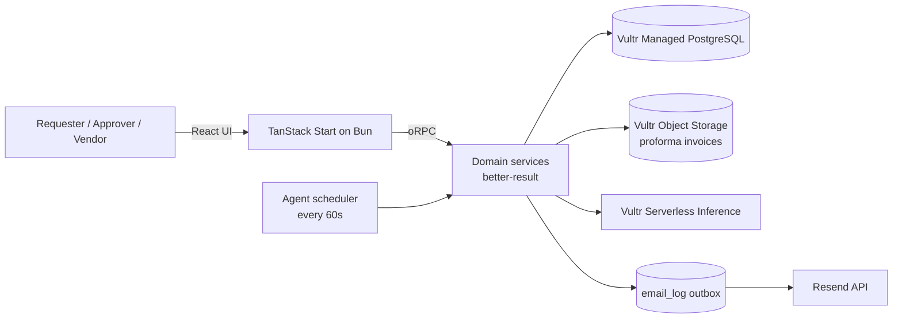

# fastprok

An agentic procurement workspace for the Vultr **Agent Rush** hackathon (Challenge 2: Procurement).

A requester describes a need in plain language. The agent turns it into a structured request, matches vendors by rules, invites them, chases non-responders, scores every quote deterministically, and asks a human approver to decide. Vendors quote inside the app and only ever see their own quote.

**Live demo:** https://fastprok.kekere.online

## Demo accounts

All accounts use the password `demo1234`.

| Role                          | Email                             |
| ----------------------------- | --------------------------------- |
| Requester                     | `lilbrown3000+buyer@gmail.com`    |
| Approver                      | `lilbrown3000+approver@gmail.com` |
| Vendor (computer peripherals) | `lilbrown3000+vendor-d@gmail.com` |
| Vendor (office furniture)     | `lilbrown3000+vendor-a@gmail.com` |
| Vendor (office furniture)     | `lilbrown3000+vendor-b@gmail.com` |
| Vendor (office furniture)     | `lilbrown3000+vendor-c@gmail.com` |

The login page has one-click demo buttons for the requester, approver, and a vendor. New teams can self-register at `/register` as an organization or a vendor.

## What the demo covers

- **Requester:** sign in, create a request from a plain-language description, watch the agent parse it, see matched vendors, compare ranked quotes, follow the agent timeline.
- **Approver:** everything a requester sees, plus approve one quote with an optional note. Only approvers can approve.
- **Vendor:** see invitations, submit a quote, attach an optional proforma invoice, edit the quote before the deadline (every version is kept), see the outcome after approval.
- **Agent:** reminder schedule, one-time vendor widening, deadline ranking, AI explanations sourced only from scored data, in-app notifications, and the email outbox.
- **Notifications:** a bell in the workspace header shows unread activity, deep-links to the request, and marks items read. The full page is at `/notifications`.
- **Browser alerts:** an optional button in the bell asks for browser notification permission. Once allowed, new activity raises a system notification while the app tab stays open. Clicking the alert opens the request.

## How the agent decides

Rules do the decisions that must be repeatable; AI only reads and explains.

- **Vendor matching:** fixed category, delivery region, lead-time fit, and past reliability/response rate.
- **Chasing:** remind non-responders when 25% of the quote window remains, at most 2 reminders per vendor.
- **Widening:** at the deadline, if fewer than 3 valid quotes exist, invite the next best vendors once and extend the deadline.
- **Ranking:** hard filters first (quantity, delivery by the needed-by date), then normalized scores for cost, speed, reliability, and warranty. Weights change with the priority mode (balanced, cheapest, fastest, most reliable). Ties break on earlier submission. The same input always produces the same ranking.
- **Explanations:** the Vultr-hosted `deepseek-v4.1-flash-1017` model writes the summary and reasons using only the scored numbers. If it fails, a deterministic template is used and the fallback is logged.
- **Human control:** the agent never approves or spends. Only an organization approver can approve.

## Stack

- **Runtime:** Bun (production server, scripts)
- **Framework:** TanStack Start + React 19, Vite+
- **API:** oRPC over an OpenAPI handler
- **Database:** Vultr Managed PostgreSQL 18 with Drizzle ORM
- **Object storage:** Vultr Object Storage, S3-compatible, through Bun's built-in S3 client
- **Auth:** better-auth (email + password)
- **AI:** Vultr Serverless Inference (`deepseek-v4.1-flash-1017`)
- **Email:** Resend HTTP API
- **Errors:** [`better-result`](https://better-result.dev) on server domain boundaries: tagged errors, explicit `Result` returns, transaction rollback on `Err`, and oRPC error mapping

## Vultr services used

- **Vultr Cloud Compute:** an Ubuntu VM runs the app through Dokploy (Railpack build, Bun runtime).
- **Vultr Managed PostgreSQL:** stores procurement data, sessions, quotes, document metadata, and the email/notification outbox. SSL is required; the CA certificate is committed at the repository root.
- **Vultr Object Storage:** keeps vendor proforma invoices in a private S3-compatible bucket. Files are served through five-minute presigned URLs after an access check.
- **Vultr Serverless Inference:** parses requests and writes quote explanations with `deepseek-v4.1-flash-1017`, using the OpenAI-compatible chat completions API.

## Architecture



## Architecture

```
src/
  domain/                 business rules and agent workflow
    request-parse.ts      Vultr AI parsing + heuristic fallback
    vendor-match.ts       deterministic vendor matching
    request-create.ts     request transaction, invitations, notifications
    quote-submit.ts       quote create/edit with revisions
    ranking.ts            pure deterministic scoring
    recommendation-ai.ts  AI wording with template fallback
    agent-tick.ts         reminders, widening, deadline ranking
    approve.ts            approver-only approval and outcomes
    proforma.ts           proforma upload, access checks, S3 metadata
    activity.ts           timeline and notification read state
  lib/
    result/               tagged errors, DB helpers, oRPC mapping
    storage.ts            Bun S3 client and presigned URLs
    orpc/                 router, procedures, client contract
  routes/                 UI pages and API handlers
  repo/schema/            auth + procurement schema
  server/                 startup migrations and agent scheduler
scripts/                  migrate and demo seeds
drizzle/                  SQL migrations
```

Postgres advisory locks make startup migrations safe across restarts. The agent scheduler starts after the first request (which also runs migrations) and runs every `AGENT_TICK_MS`. The request detail page has a **Run agent check** button for the demo.

## Local setup

Requires Node 22+, pnpm, and Bun.

```bash
pnpm install
cp .envrc.example .envrc   # fill in the values
source .envrc
pnpm build
bun .output/server/index.mjs
```

The server runs migrations at startup. Seed the demo data once:

```bash
bun scripts/seed.ts
bun scripts/seed-demo-proforma.ts   # optional sample proforma on the USB-C quote
```

Then open `http://localhost:3000`.

### Environment

| Variable                           | Purpose                                                     |
| ---------------------------------- | ----------------------------------------------------------- |
| `DB_URL`                           | PostgreSQL connection string                                |
| `DB_SSL_CA`                        | path to the CA certificate (default `./ca-certificate.crt`) |
| `BETTER_AUTH_SECRET`               | better-auth signing secret                                  |
| `APP_BASE_URL`                     | public app URL used in emails                               |
| `BETTER_AUTH_BASE_URL`             | public auth URL                                             |
| `RESEND_API_KEY`, `RESEND_FROM`    | Resend credentials and sender                               |
| `VULTR_INFERENCE_API_KEY`          | Vultr inference key                                         |
| `VULTR_INFERENCE_MODEL`            | defaults to `deepseek-v4.1-flash-1017`                      |
| `AWS_ACCESS_KEY`, `AWS_SECRET_KEY` | Vultr Object Storage credentials                            |
| `AWS_HOST_BASE`                    | S3 endpoint host, for example `ams1.vultrobjects.com`       |
| `AWS_BUCKET`                       | private bucket for proforma invoices                        |
| `AWS_REGION`                       | S3 signing region, defaults to `us-east-1`                  |
| `DEMO_MODE`                        | short quote windows in minutes                              |
| `DEMO_EMAIL_OVERRIDE`              | redirect non-demo recipients to one inbox                   |
| `AGENT_TICK_MS`                    | scheduler interval                                          |

See `src/env/server.ts` for every option and its default.

## Tests

```bash
pnpm test
pnpm exec tsc --noEmit
```

The ranking engine has coverage for priority modes, hard filters, partial quantity, over-budget flags, tie-breaking, and determinism.

## Deployment

The app is deployed with Dokploy on a Vultr VM and served at `https://fastprok.kekere.online`. The build runs with pnpm/Vite+, and the production server is Bun running Nitro's `node-server` output. Vultr Managed PostgreSQL requires SSL; the CA certificate lives at the repository root.

## Limitations and next steps

- Email replies are not read; vendors quote in the app. Inbound email parsing is the next step.
- Delivery tracking and delay chasing are out of scope for this demo.
- Single currency (NGN) and a fixed category list keep the demo focused.
- Proforma invoices are limited to PDF, PNG, or JPG files up to 5 MB. They are stored privately and are not virus-scanned.
- Vendor reliability is seeded history; the next version should update it from completed orders.
- Member invitations, multiple contacts per vendor, and a rejection flow are intentionally deferred.

## Scope

Built for a reliable demo: member invites, multiple vendor contacts, rejection flow, orders/delivery tracking, AI-written email wording, password reset, email verification, and multi-currency are intentionally out of scope.
